# ⚡ Awesome Developer Environment & Cloud IDE Config

  

  
  
  
  
  
  

---

## 🌟 Top Developer Environment & Cloud IDE Config Ecosystem

**Curated List of SaaS/Hosted Platforms & Open-Source GitHub Projects**  
*Focused on Cloud Development Environments (CDEs), Reproducible Nix & DevContainer Configs, Self-Hosted Browser IDEs & Ephemeral Developer Workspaces*  
📅 **Last updated: November 2026**

This repository tracks notable **SaaS/hosted platforms** and **open-source projects** for **Developer Environment & Cloud IDE Config**. These tools define, provision, containerize, configure, and host reproducible cloud development environments and browser-based IDEs using declarative `devcontainer.json`, `devfile.yaml`, `nix`, and Terraform templates across cloud sandboxes, Kubernetes clusters, and local developer machines.

**Leading Examples** include Gitpod (Ona), GitHub Codespaces, Replit, Codeanywhere, StackBlitz, AWS Cloud9, Eclipse Che, Coder, DevZero, Daytona, and fzn0x/idx.

**Open-source emphasis**: This section is heavily expanded with every major active project for Cloud Development Environment (CDE) orchestration (`Coder`, `Daytona`, `DevPod`, `Eclipse Che`), Nix & declarative environment configuration (`fzn0x/idx`, `devenv.sh`, `Devbox`, `Flox`), and self-hosted browser IDEs & DevContainer specifications (`Code-Server`, `OpenVSCode Server`, `Dev Containers CLI`) — ideal for platform engineers, DevOps teams, open-source maintainers, and developers standardizing reproducible workspaces.

> 🤝 **Contributions welcome!** Open a PR to add or update entries. Keep descriptions factual and link to official sites.

---

## 📑 Table of Contents
- [📊 Sector Overview & Market Dynamics](#-sector-overview--market-dynamics)
- [☁️ SaaS/Hosted Platforms](#️-saashosted-platforms)
- [🔓 Open-Source GitHub Projects](#-open-source-github-projects)
- [🛠️ How to Contribute](#️-how-to-contribute)
- [📈 Star History](#--star-history)
- [💖 Support & Share](#-support--share)
- [⚠️ Disclaimer](#️-disclaimer)

## 📊 Sector Overview & Market Dynamics

The global Cloud Development Environment (CDE) and Cloud IDE sector is estimated at **$2.5B–$4.5B** within the broader **$12.5B+** software development tooling market, expanding at a CAGR of ~8–12% driven by remote team onboarding, security governance, and AI agent execution sandboxes. The market exhibits a **bifurcated, moderately fragmented structure**: top-tier cloud hyperscalers (Microsoft GitHub, Amazon AWS, Google) command concentrated enterprise developer distribution, while an active, fragmented ecosystem of independent orchestrators and AI-first sandbox startups (Replit, Daytona, Coder, StackBlitz) aggressively compete on ephemeral boot times, browser WebContainers, and zero-trust workspace security.

## ☁️ SaaS/Hosted Platforms

| Platform | Valuation / Company Scale | Starting Pricing | Free Tier / Trial Limits | Description |
| :--- | :--- | :--- | :--- | :--- |
| **[AWS Cloud9](https://aws.amazon.com/cloud9/)** | **~$2.1T+ Market Cap** (Amazon / AWS Cloud: $100B+ ARR) | Pay-as-you-go for underlying AWS compute (e.g., ~$0.0104/hr for `t3.micro` EC2) | **750 hours/month** of `t2.micro` or `t3.micro` EC2 instances and **30 GB** EBS storage under the AWS Free Tier (first 12 months) | Cloud-based IDE running directly on EC2 instances with pre-authenticated AWS CLI access, collaborative code editing, and integrated terminal. *(Legacy service for existing AWS accounts).* |
| **[Firebase Studio](https://firebase.google.com)** | **~$2.0T+ Market Cap** (Alphabet / Google) | Included with Google Cloud Platform resource usage | **3 free workspaces** permanently included with Google accounts (up to 10–30 workspaces for Google Developer Program members) | Google's cloud-based developer workspace (formerly Project IDX) built on `.idx/dev.nix` declarative Nix configurations, full-stack emulators, and Gemini code assistance. *(Sunsetting March 2027).* |
| **[GitHub Codespaces](https://github.com/features/codespaces)** | **~$3.0T+ Market Cap** (Microsoft / GitHub: $1B+ ARR) | **$0.18/hour** (2-core compute) + **$0.07/GB-month** for storage beyond monthly free allowance | **60 hours/month** (120 core hours) of 2-core compute and **15 GB** storage free forever for all personal GitHub accounts (180 core hours & 20 GB on GitHub Pro) | Cloud-hosted development environments deeply integrated with GitHub repositories, containerized with `devcontainer.json`, supporting browser and desktop VS Code. |
| **[Replit](https://replit.com)** | **$9.0B Valuation** (Raised $400M Series D in 2026; $900M+ total funding) | **$20/month** (Core plan, or $18/month billed annually) | **Unlimited public Repls** with basic compute (0.5 vCPU, 512 MB RAM) free forever; includes initial AI agent evaluation credits | Collaborative cloud IDE and instant hosting platform driven by Nix environments, real-time multiplayer editing, and autonomous Replit Agent workflows. |
| **[Daytona Cloud](https://daytona.io)** | **$1.0B Valuation** (Raised $60M Series B in 2026; $91M total funding) | **$0.02/core-hour** (Pay-as-you-go elastic sandbox billing) | **$200 in free compute credits** upon sign-up (up to $50,000 for qualifying startups) for ephemeral workspaces | Elastic development environment and sandbox runtime provisioning secure standardized workspaces and AI code-execution sandboxes with sub-second cold starts. |
| **[StackBlitz](https://stackblitz.com)** | **$700M Valuation** (Raised $135M+ total capital across Series A & B) | **$25/month** (Pro plan, or $18/month billed annually) | **Unlimited public projects** and unlimited browser execution sessions free forever powered by WebContainers | Instant web-native IDE utilizing WebContainers to run Node.js, Vite, Next.js, and package runtimes directly inside browser sandboxes without remote VM lag. |
| **[Coder Enterprise](https://coder.com)** | **$500M–$1.0B Valuation** (Raised $90M Series C; $175M total funding) | **$35/user/month** (Premium tier starting rate, billed annually) | **Free forever Community Edition** (self-hosted, unlimited workspaces and single-organization users with community support) | Self-hosted and enterprise-managed CDE platform provisioning developer workspaces via Terraform onto private VPCs, Kubernetes, and hybrid clouds. |
| **[Gitpod (Ona)](https://gitpod.io)** | **~$150M–$250M Valuation** (Raised $41M total funding across Seed & Series A) | **$9/user/month** (Pay-as-you-go / Team plan) | **50 hours/month** of workspace runtime and standard compute free forever on public and connected repositories | Ephemeral Cloud Development Environment (CDE) platform standardizing zero-drift developer workspaces and AI agent sandboxes from Git branches. |
| **[DevZero](https://devzero.io)** | **~$80M–$120M Valuation** (Raised $26M total funding; $21M Series A) | **$39.95/user/month** (Pro plan) | **2 active workspaces**, 2 users, and monitoring for unlimited Kubernetes clusters free forever on the Starter tier | Developer environment platform delivering pre-warmed, reproducible remote workspaces with automated multi-tier microservice dependencies and local IDE sync. |
| **[Codeanywhere](https://codeanywhere.com)** | **~$15M–$30M Valuation** (~$330K ARR; raised $600K Seed/Series A) | **$12/month** (Basic plan, or $10/month billed annually) | **7-day full-access free trial** (with 1 container, 2 GB RAM, and 10 GB disk space); no permanent free container tier | Web-based cloud IDE and container workspace manager supporting `devcontainer.json` provisioning, SSH/SFTP terminal access, and browser-hosted VS Code. |

## 🔓 Open-Source GitHub Projects

Curated list of open-source Cloud Development Environment (CDE) orchestrators, container workspace runtimes, runtime managers, and declarative Nix configurations—ranked by GitHub stars:

- **[Code-Server](https://github.com/coder/code-server)**   
  🖥️ Runs VS Code on any remote Linux machine, cloud VM, or container and serves it through any web browser with full terminal and extension marketplace support.

- **[Daytona](https://github.com/daytonaio/daytona)**   
  🚀 Open-source Development Environment Manager and elastic workspace runtime that sets up fully configured development environments with a single command across local and cloud providers.

- **[mise-en-place](https://github.com/jdx/mise)**   
  🛠️ High-performance polyglot runtime tool manager, environment variable orchestrator, and task runner (alternative to asdf and direnv) configured via `mise.toml`.

- **[Nixpkgs](https://github.com/NixOS/nixpkgs)**   
  ❄️ The world's largest repository of reproducible software packages and declarative operating system configurations powering modern reproducible developer environments.

- **[asdf](https://github.com/asdf-vm/asdf)**   
  🔧 Extendable CLI runtime version manager with support for Node.js, Python, Ruby, Elixir, Go, and hundreds of language runtimes via a unified `.tool-versions` config.

- **[Chezmoi](https://github.com/twpayne/chezmoi)**   
  🏠 Manage your personal dotfiles, shell configs, secret managers, and SSH keys securely across multiple local, remote, and ephemeral cloud development machines.

- **[Eclipse Theia](https://github.com/eclipse-theia/theia)**   
  🌐 Extensible open-source platform and framework for building rich web and desktop IDE-like applications with TypeScript and VS Code extension protocol compatibility.

- **[Coder](https://github.com/coder/coder)**   
  🏗️ Self-hosted Cloud Development Environment (CDE) engine that provisions developer workspaces on Linux VMs, Kubernetes, Docker, or cloud hyperscalers using Terraform.

- **[direnv](https://github.com/direnv/direnv)**   
  📁 Lightweight shell extension that automatically loads and unloads directory-scoped environment variables, secrets, and Nix/Devbox environments as you change folders.

- **[DevPod](https://github.com/loft-sh/devpod)**   
  📦 Client-only open-source alternative to GitHub Codespaces; turns any repository containing a `devcontainer.json` into a reproducible remote environment over SSH, Docker, or Kubernetes without a backend server.

- **[Devbox](https://github.com/jetify-com/devbox)**   
  ⚡ Instant, isolated development environments powered by Nix without requiring you to learn the Nix language; configured declaratively via clean `devbox.json` files.

- **[Podman Desktop](https://github.com/containers/podman-desktop)**   
  🦭 Open-source graphical desktop interface for managing containers, Pods, Kubernetes environments, and DevContainers with rootless security.

- **[Dotbot](https://github.com/anishathalye/dotbot)**   
  🤖 Lightweight, bootstrap-friendly dotfiles management tool designed to symlink configuration files seamlessly inside fresh VMs, cloud containers, and DevContainers.

- **[devenv](https://github.com/cachix/devenv)**   
  🧪 Fast, declarative, reproducible developer environments builder powered by Nix—orchestrating packages, background services (Postgres, Redis), and process managers in `devenv.nix`.

- **[Eclipse Che](https://github.com/eclipse-che/che)**   
  ☁️ Kubernetes-native cloud development workspace platform providing multi-tenant `devfile.yaml` workspace management, in-browser IDEs, and enterprise SSO integration.

- **[OpenVSCode Server](https://github.com/gitpod-io/openvscode-server)**   
  💻 Upstream distribution maintained by Gitpod that runs the upstream Microsoft VS Code web client directly on a remote server accessible through any standard web browser.

- **[Dev Containers Specification](https://github.com/devcontainers/spec)**   
  📋 The open specification and schema behind `devcontainer.json`, standardizing how development containers, features, port forwardings, and lifecycle hooks are declared.

- **[VS Code Dev Containers Templates](https://github.com/microsoft/vscode-dev-containers)**   
  📐 Microsoft repository of reference community templates, Dockerfiles, and DevContainer configuration definitions for common stacks and languages.

- **[Flox](https://github.com/flox/flox)**   
  🔄 Cross-platform developer environment framework based on Nix that provides portable, reproducible environments that follow your code across local machines, CI, and production.

- **[Dev Containers CLI](https://github.com/devcontainers/cli)**   
  ⌨️ Reference command-line interface implementation for parsing, building, and executing workspaces defined by `devcontainer.json`.

- **[fzn0x/idx](https://github.com/fzn0x/idx)**   
  🔮 Open-source configuration toolkit and Nix templates inspired by Project IDX, engineered to bootstrap reproducible cloud workspace setups and developer tooling.

**Frameworks for building custom systems**: Combine **Dev Containers (`devcontainer.json`) + DevPod** or **Coder** for self-hosted cloud workspaces, **devenv** or **Devbox + direnv** for zero-drift Nix developer environments, and **OpenVSCode Server** or **Code-Server** for browser-based IDE access.

## 🛠️ How to Contribute

1. 🍴 Fork the repository.
2. 📝 Add or edit entries in `README.md` (following the existing format and structure).
3. 🔗 Include: project/platform name, official link, 1–2 sentence description, and whether it's SaaS/hosted or open-source.
4. 🚀 Submit a Pull Request with a clear, descriptive title.

⭐ *Star the repo if you find it helpful!*

##  Star History

## 💖 Support & Share

A heartfelt **thank you** for checking out and supporting this curated resource! Maintaining and researching reproducible cloud development environments, developer sandboxes, and modern configuration toolchains takes continuous exploration. 

If you find this curated list helpful, please consider supporting the project:

- ⭐ **Star this repository** to help other developers and platform engineers discover it.
- 🍴 **Fork & Share** it with your team, engineering colleagues, or community on [X / Twitter](https://twitter.com), [LinkedIn](https://linkedin.com), and [Reddit](https://reddit.com).
- ☕ **Buy me a coffee / Sponsor** my open-source work via the [Sponsor Dashboard on GitHub Sponsors](https://github.com/sponsors/ishandutta2007) — featuring tiers for profile badges, README shoutouts, logo placements, and prioritized bug fixes & feature requests!

  

## ⚠️ Disclaimer

- 📌 This is a **community-curated** list — not exhaustive and not an endorsement.
- 🔒 Never hardcode cloud credentials, `.env` secrets, or private SSH keys inside committed `devcontainer.json`, `devenv.nix`, or `devfile.yaml` repository files; inject secrets dynamically at workspace startup via secret managers or encrypted dotfiles (`Chezmoi + age/SOPS`).
- 🛡️ Self-hosted Cloud IDE servers (`Coder`, `Code-Server`, `OpenVSCode Server`) expose full interactive shell access over HTTP/WebSockets; always protect them behind HTTPS/TLS reverse proxies, OIDC/SSO authentication, and strict network firewall rules.

---

  Made with ❤️ for platform engineers, DevOps teams, open-source maintainers, and cloud-native developers. 
  Let's make developer environment configuration and cloud IDEs open, reproducible, and portable.

